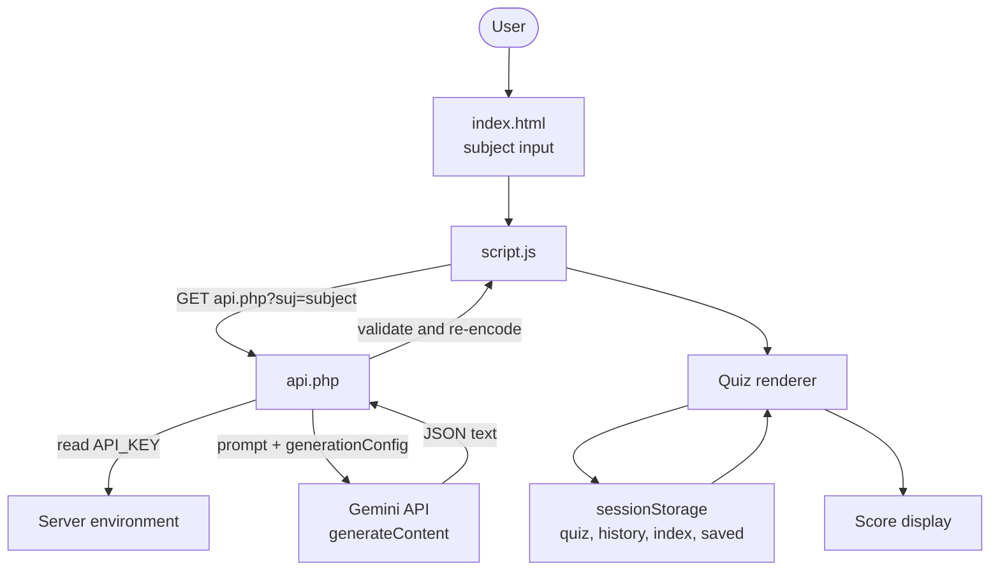
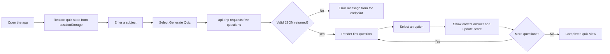

<div align="center">


<p><strong>A quiz generator that asks Gemini for five multiple-choice questions on any subject and renders them as an interactive test.</strong></p>

</div>

<div align="center">

<a href="https://github.com/mohammed-laabidi/Quiz-Ai-Generate"></a>
<a href="https://github.com/mohammed-laabidi/Quiz-Ai-Generate/fork"></a>
<a href="https://github.com/mohammed-laabidi/Quiz-Ai-Generate/issues"></a>


</div>

<div align="center">

<a href="https://github.com/mohammed-laabidi/Quiz-Ai-Generate"><strong>Repository</strong></a>

</div>

## Overview

QuizAi turns a single keyword into a complete quiz. The user types a subject such as JavaScript, PHP, or Python, the front end calls a small PHP endpoint, and the endpoint asks Google Gemini for exactly five multiple-choice questions with four choices each and one correct answer. The returned JSON is parsed and rendered as an interactive quiz with navigation, answer checking, and a live score.

The PHP layer keeps the API key out of the browser. `api.php` reads the key from the `API_KEY` environment variable, builds a prompt that requires strict JSON, requests `application/json` as the response MIME type, strips Markdown fences if they appear, validates the payload, and forwards it to the client.

Quiz progress, answer history, and the list of saved questions are kept in `sessionStorage`, so a quiz survives a page refresh in the same tab but does not persist after the session ends.

## Features

<table>
<tr>
<td width="50%" valign="top">


### AI question generation

Any subject produces five questions with four options each, generated by Gemini from a strict JSON prompt.

</td>
<td width="50%" valign="top">


### Real-time scoring

Answering a question updates the score counter in the header, and reviewed answers show the correct option.

</td>
</tr>
<tr>
<td width="50%" valign="top">


### Question navigation

Previous and next controls move between questions, and the current index is stored so a refresh returns to the same question.

</td>
<td width="50%" valign="top">


### Saved questions

A dedicated list keeps questions to revisit, restored from `sessionStorage` on reload.

</td>
</tr>
<tr>
<td width="50%" valign="top">


### Shuffled choices

Options are shuffled before rendering, so the correct answer does not sit in a predictable position.

</td>
<td width="50%" valign="top">


### Escaped output

Question and option text pass through an escaping helper before being injected into the page.

</td>
</tr>
</table>

## Technology Stack

<div align="center">


</div>

| Technology | Purpose |
| --- | --- |
| HTML5 | Quiz shell, subject input, score, and saved list containers |
| CSS3 | Layout, answer states, and two responsive breakpoints |
| JavaScript | Fetching, rendering, navigation, scoring, and session state |
| PHP | Server endpoint that calls the Gemini API |
| cURL | HTTP client used by the endpoint to reach Google |
| Google Gemini API | Generates the questions |
| Web Storage API | `sessionStorage` persistence of quiz state |
| Apache | Serves the PHP endpoint locally or in production |

## Architecture

The browser never sees the API key. It talks only to `api.php`, which forwards the prompt to Gemini and returns validated JSON.



## Application Flow



## Project Structure

```text
Quiz-Ai-Generate/
├── index.html
├── style.css
├── script.js
├── api.php
├── .htaccess
├── .gitignore
└── README.md
```

## Getting Started

### Prerequisites

- PHP 8 or later with the cURL extension
- A web server such as Apache (XAMPP, WAMP, or a production host)
- A Gemini API key from Google AI Studio

### Environment variables

| Variable | Description | Required |
| --- | --- | --- |
| `API_KEY` | Gemini API key read by `api.php` | Yes |

The key is read with `getenv("API_KEY")` and is never written into the source files. Set it in the server configuration, in a virtual host, or in the environment of the process that runs PHP.

### Installation

```bash
git clone https://github.com/mohammed-laabidi/Quiz-Ai-Generate.git
```

Place the folder inside the web root of the server, for example `C:\xampp\htdocs\Quiz-Ai-Generate`, and start Apache. If the key is not available to the web server process, `api.php` answers with HTTP 500 and an `API key not configured` message.

Then open the project through the local server, for example `http://localhost/Quiz-Ai-Generate/`.

## Usage

1. Enter a subject in the field, for example `javascript` or `python`.
2. Select Generate Quiz. Five questions are requested from the API.
3. Answer each question and use the navigation controls to move between them.
4. Save a question with the save control to add it to the saved list, and reopen the list with Show Saved.
5. Review the score in the header. Refresh the tab to confirm that the quiz state is restored.

## API Documentation

### Generate quiz questions

| Method | Endpoint | Description |
| --- | --- | --- |
| `GET` | `api.php?suj={subject}` | Returns five multiple-choice questions for the subject |

Example request:

```text
GET /Quiz-Ai-Generate/api.php?suj=javascript
```

Example response:

```json
[
  {
    "question": "Which keyword declares a block-scoped variable?",
    "choices": ["var", "let", "function", "return"],
    "correctAnswer": "let"
  }
]
```

The endpoint responds with a JSON array of exactly five objects. On failure it returns HTTP 500 when the API key is missing, or HTTP 502 when the request to Gemini fails or the returned content is not valid JSON.

## Security

- The Gemini key stays on the server and is read from an environment variable rather than from a committed file.
- The endpoint validates that the upstream response is valid JSON before returning it.
- The front end escapes generated text before inserting it into the document.
- For a public deployment, restrict the endpoint to the expected origin and add rate limiting, since each generation consumes API quota.

## Deployment

The project needs a PHP runtime with cURL, so it cannot be hosted on GitHub Pages. Deploy it to any PHP-capable host, set `API_KEY` in the server environment, and serve the folder over HTTPS.

## Author

<table>
<tr>
<td valign="top">

**Mohammed Laabidi**

<a href="https://github.com/mohammed-laabidi"> GitHub</a>
&nbsp;&nbsp;
<a href="https://www.linkedin.com/in/mohammed-laabidi-793a40436"> LinkedIn</a>
&nbsp;&nbsp;
<a href="mailto:mohammedlaabidi19@gmail.com"> Email</a>

</td>
</tr>
</table>

## Acknowledgments

- Google Gemini API for question generation
- Google AI Studio for API key management

---

If this project is useful to you, consider giving the repository a star.
